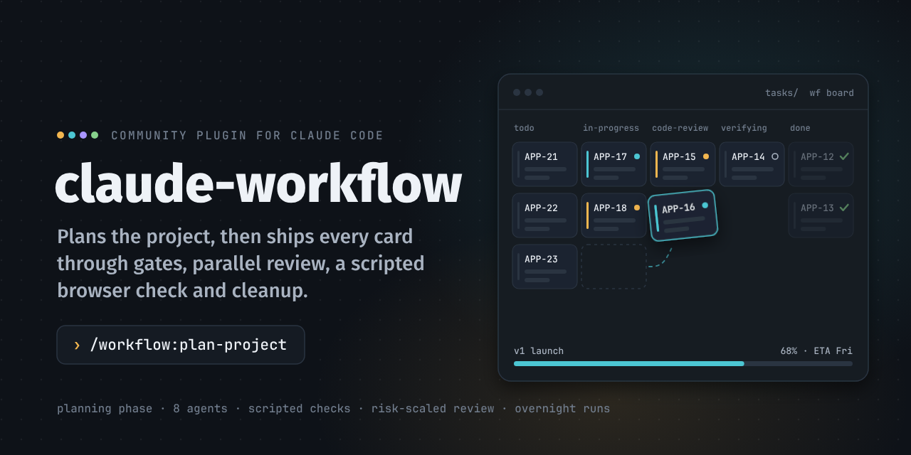
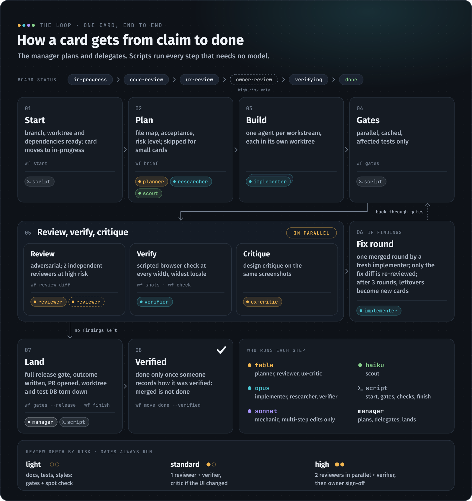
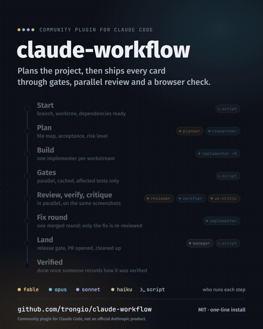

# claude-workflow



A Claude Code plugin that turns your session into an engineering manager. It
plans the project, splits each task into briefs, delegates them to tiered
subagents working in their own git worktrees, runs your quality gates, scales
review depth by risk, checks the result in a real browser, and records every
task on a markdown board in your repo.

The bookkeeping is scripted. Branches, worktrees, gate runs, page checks,
outcome records and cleanup are `wf` commands that print a few lines, so the
model spends its tokens on judgment instead of on clicking and reading logs.

> This is a community plugin for [Claude Code](https://docs.claude.com/en/docs/claude-code).
> It is not an Anthropic product and is not endorsed by Anthropic.

## Set it up with one prompt

Open Claude Code in the repo you want to use it in and paste this:

```text
Set up the claude-workflow plugin (github.com/trongio/claude-workflow) in this repo, end to end.
Ask me before anything destructive (deleting, overwriting, force flags) and do not push during setup.

1. Install it at project scope with Bash:
   claude plugin marketplace add trongio/claude-workflow --scope project
   claude plugin install workflow@trongio --scope project
   (if the marketplace is already added: claude plugin marketplace update trongio)
2. Check that bun, jq and git are on PATH, plus bash 4 or newer, and gh if tasks will land as PRs. For each missing tool,
   tell me the install command for this OS and ask before running it.
3. Ask me to type /reload-plugins so the workflow skills load, and wait until I have.
4. If this repo is empty or has no docs/STACK.md and no clear stack, ask me to run
   /workflow:plan-project. Otherwise ask me to run /workflow:init. Answer its questions with me.
5. Ask me how tasks should land and set it in .claude/workflow.json: finish.mode "pr" with
   push true (needs gh and a remote; recommended when the main checkout is served by a dev
   server or shared with other sessions), or finish.mode "merge" (local, never pushes; only
   when nothing serves from the main checkout). PR mode refuses to finish while push is false.
6. Run `wf doctor` and fix every failure that is configuration; list the rest for me.
7. Show `wf status` and explain in a few lines what was set up, what I should fill in by hand
   in .claude/workflow.json, and how to start the first task (/workflow:task "<what to build>").
Do not commit unless I ask.
```

Prefer a shell? `curl -fsSL
https://raw.githubusercontent.com/trongio/claude-workflow/main/install.sh |
bash` adds the marketplace and installs the plugin (`bash -s -- --project`
for project scope).

## Why

It comes from two production projects (a multi-tenant SaaS with hardware in
the loop, and a commerce platform) where it ran daily, including unattended
overnight runs. Every rule in the prompts and scripts exists because its
absence once cost a shipped defect or a lost afternoon. A few of them:

- **A scripted page check returns one JSON line** (status, console errors,
  overflow, clipped text, screenshot path). In one of those projects,
  step-by-step browser driving cost about 6M tokens across 739 sessions. The
  verifier runs scripts first and opens a browser only for what a script
  cannot judge.
- **Merged is not done.** A fully green merge once shipped two critical bugs
  that a review loop caught only afterwards. Cards now land in `verifying`,
  and reach `done` only with a note on how the change was observed working.
- **Zero overflow is not visual verification.** A layout check passed while a
  label in the widest locale broke mid-word and a sentence clipped inside a
  scrolling cell. Checks run in the locale with the longest strings, and the
  screenshots are opened and looked at.
- **A disabled gate looks exactly like a green one.** A reset git hooks path
  silently switched off every pre-commit check for an unknown period. Now a
  skipped, pending or missing gate reports "not proven", and `wf doctor`
  checks the hooks path.
- **A comment is not a mechanism.** "Kept in sync with X" sat above a copy
  that had already drifted. The reviewer flags such comments and asks for a
  shared import.
- **Scripts beat repetition.** One seven-step integration sequence was typed
  by hand seven times before it became a script. The rule now: the third
  repetition becomes a command.

## The lifecycle





```
 wf start      branch wf/<ID> + its own worktree, card -> in-progress
 plan          planner reads the spec and standards -> file map, risk, briefs
 mocks         UX-heavy only: 2-3 HTML mocks, the owner's pick is the spec
 delegate      implementers in parallel, each in a worktree, brief from wf brief
 integrate     merge streams -> wf gates (fast: affected tests only)
 review        IN PARALLEL: reviewer(s) + verifier (wf shots, wf check) + ux-critic
 fix           one merged fix round by a fresh implementer; only the fix diff is re-reviewed
 release       wf gates --release: every gate, uncached; a subset is not green
 outcome       wf outcome writes the record; the manager fills the prose
 owner hold    high risk without owner approval parks in owner-review, in every mode
 wf finish     land per finish.mode and tear down the worktree, DB and ports:
                 pr: push, open or update the PR, card parks in owner-review until
                     the PR merges; run wf finish <ID> again after the merge to move
                     it to verifying and delete the branch
                 merge: merge into baseBranch under the lock, card -> verifying
               wf doctor shows no leftovers
 done          wf move <ID> done --verified "how it was observed"
```

Review depth scales with risk. `wf risk` decides it from the diff (`wf risk
--explain` shows which file and pattern decided):

| Level | Covers | Required |
|---|---|---|
| light | only `*.md`, `docs/`, `tests/` or `*.css` changed | gates plus a manager spot check of the diff; no reviewer agent, no simplify pass |
| standard | anything that is neither light nor high | gates, `review.minPasses` reviewer rounds (default 1), verifier, ux-critic if the look changed |
| high | a path in `risk.high`; when that is unset, built-in patterns: migrations, auth, billing and payment, security, infra and deploy, CI workflows, Dockerfiles, `*.sql` | two independent reviewers at once plus `review.extraAgents.high`, verifier, ux-critic, then the owner (`review.ownerHoldHigh`) |

Fix rounds are capped (`review.maxRounds`, `ux.maxFixRounds`); remaining
minors become cards instead of another round.

## The planning phase


Before the first card, `/workflow:plan-project` (details in
[`skills/plan-project/SKILL.md`](skills/plan-project/SKILL.md)) runs a short
planning phase on an empty or young repo:

1. `wf detect` reads what exists; 2-3 researchers (one per candidate stack
   family) survey stacks in parallel with versions from `wf versions` (each
   with its release URL and fetch date, never recalled), support windows,
   ecosystem and hosting cost.
2. At the same time the ux-critic proposes two design directions (system,
   type scale, density, colour use, tone) under anti-template rules.
3. The planner scores the options; the owner decides. The decision is
   recorded in `docs/STACK.md`, the standards in `docs.standards`, and the
   gates that enforce them in `.claude/workflow.json`.
4. `wf plan scaffold` renders the docs and config, the planner tunes the
   marked `<!-- tune -->` blocks, and `wf plan cards` seeds a first milestone
   of cards.

On an existing repo, `/workflow:init` does the setup part only.

## Agents

| Agent | Model | Job |
|---|---|---|
| `planner` | fable | file-level plan, acceptance criteria, risk, self-contained briefs (read-only) |
| `reviewer` | fable | adversarial review with a grade per touched area (read-only) |
| `ux-critic` | fable | design critique of the screenshots; design directions (read-only) |
| `implementer` | opus | one workstream: code, tests, gates, cleanup |
| `researcher` | opus | library internals, external APIs, stack surveys (read-only) |
| `verifier` | opus | scripted page checks first, browser second, at every viewport |
| `mechanic` | sonnet | multi-step mechanical edits (never a single command) |
| `scout` | haiku | "where is X" lookups (read-only) |

`fable` is the strongest model alias. To use other models, set `models` in
`.claude/workflow.json` (for example `{"planner": "opus"}`): the manager
passes that value as the model whenever it spawns the role. Or override the
agent in `.claude/agents/`.

Who does what, the same in every prompt: the manager and implementers run
`wf gates` (reviewers never run gates; they read the table they are given);
`wf outcome` writes the record and the manager fills its prose; every agent
cleans up what it started before it reports, and `wf finish` tears down the
task's worktree.

## Commands

Skills (type them in Claude Code):

| Skill | What it does |
|---|---|
| `/workflow:plan-project` | stack decision, standards and gates before any card |
| `/workflow:init` | set up an existing repo: config, board, CLAUDE.md section, doctor |
| `/workflow:task <ID or text>` | one task through the whole lifecycle |
| `/workflow:next [n or drain]` | claim cards and run each independently in the background |
| `/workflow:gates [--release]` | run the gates and print the table |
| `/workflow:board [serve]` | board summary, or the live board page |

`wf` (on Claude's Bash PATH while the plugin is enabled; for your own shell,
`ln -s ~/.claude/plugins/cache/trongio/workflow/*/bin/wf ~/.local/bin/wf`):

| Area | Commands |
|---|---|
| Cards | `wf new`, `wf list`, `wf next`, `wf claim`, `wf show`, `wf move ID STATUS [--verified "how"]`, `wf note`, `wf park ID "owner: ..."`, `wf prio`, `wf status`, `wf board` |
| Task lifecycle | `wf start ID`, `wf plan-save ID FILE`, `wf brief ID --stream N`, `wf risk [BASE] [--explain]`, `wf outcome ID [--tick 1,2]`, `wf finish ID`, `wf cards-commit -m "msg"` (on `baseBranch` only), `wf handoff` |
| Gates | `wf gates [--release] [--json] [--last] [--fix] [--only a,b]` (an unknown name is an error), `wf gate-log [GATE]`, `wf test-affected [BASE]` |
| Health | `wf doctor [--strict]`, `wf orphans [--kill ID or DIR] [--all]`, `wf prune [--apply [ID]]`, `wf fix-sweep [--since DATE]` |
| Verification | `wf check URL... [--viewports] [--locale] [--expect TEXT]`, `wf shots ID [paths]`, `wf flow FILE.json`, `wf preview up or down ID` |
| Search and text | `wf rgx PATTERN [PATH]`, `wf outline FILE`, `wf doc FILE [section]`, `wf review-diff [BASE]`, `wf lang get or set or missing` |
| Planning | `wf detect [--json]`, `wf versions PKG... or --check docs/STACK.md`, `wf plan set or scaffold or cards` |
| Overnight | `wf queue N`, `wf run`, `wf night N` (stop with `touch .workflow/STOP`) |

Every command has `--help`; `wf help` lists them all.

## Configuration

`.claude/workflow.json`. A full example is
[`workflow.example.json`](workflow.example.json); every key is described in
[`schema/workflow.schema.json`](schema/workflow.schema.json).

| Key | Default | Meaning |
|---|---|---|
| `idPrefix`, `baseBranch`, `wipLimit`, `timezone` | repo initials, origin HEAD, 2, system | card ids, landing target, max active cards, card dates |
| `milestone.label` | `milestone` | name of the goal milestone cards count toward |
| `board.title`, `board.host`, `board.port` | `<repo> board`, 127.0.0.1, 8095 | the live board page |
| `push` | false | whether `wf finish` may push; `finish.mode` `pr` requires true |
| `gates[]` | detected | `{name, cmd, when, fix, cache, cwd, timeout, pending, release, inner, rerun: {when, max}, heavy}`; `inner: false` = release only |
| `gatesCache`, `gatesCacheKeys`, `gatesJobs`, `gatesTailLines` | true, 8, CPU/2, 30 | cache switch; cache entries per gate so parallel worktrees do not evict each other; heavy gates at once; output lines per failing gate |
| `release.cmd`, `release.log` | all release gates, `.workflow/release.log` | the full CI command that authorizes landing, and its log |
| `testAffected.cmd`, `testAffected.map[]` (`src`, `tests`) | | map from source globs to tests for the inner loop |
| `worktree.link`, `copy`, `cache`, `setup`, `env`, `pool` | detected, pool 0 | make each worktree runnable: dirs to hardlink, files to copy, copy-on-write build caches, setup commands, per-worktree env (`{id}`, `{slug}`, `{port}`), warm pool size |
| `worktree.teardown` | [] | commands run when a worktree is removed, same placeholders, e.g. `dropdb --if-exists app_{slug}` |
| `preview.cmd` | | serves one worktree for `wf preview up ID` (`{port}`, `{id}`, `{slug}`) |
| `finish.mode`, `squash`, `autoMerge`, `cleanup` | `pr`, true, false, true | how `wf finish` lands a task (`pr`, `merge` or `none`) |
| `tracker.kind`, `requireLink`, `onMerge` | none, false, "" | mirror cards to GitHub issues; `onMerge` runs on landing |
| `planner.skipFor` | `["S"]` | card sizes that skip the planner |
| `review.minPasses`, `maxRounds`, `extraAgents`, `ownerHoldHigh` | 1, 3, {}, true | reviewer rounds for standard and high risk, round cap, extra agents per risk, owner hold on high |
| `ui` | detected | whether there is a UI to verify and critique |
| `dev.url`, `login`, `loginFlow`, `viewports`, `check`, `screenshots` | url detected; loginFlow `.workflow/login.flow.json`; viewports `[375, 1440]`; screenshots `.workflow/shots` | the local dev app, login hints (where credentials live, never the secret), the sign-in flow `wf shots` reuses, widths, an optional project check command, screenshot dir |
| `ux.locales`, `widestLocale`, `localeDir`, `maxFixRounds` | localeDir detected; maxFixRounds 2 | shipped locales, the locale visual checks run in, the catalogs `wf lang` edits, UX fix round cap |
| `docs.spec`, `docs.standards`, `docs.design` | [] | ground truth for planner, every agent, the critic |
| `risk.high` | built-in patterns | path globs that make a diff high risk |
| `models` | | model per agent role; the manager passes it when spawning that role |
| `stack.id`, `stack.ui`, `stack.decided` | | written by `/workflow:plan-project` |
| `overnight.parallel`, `maxHours`, `timeoutMinutes`, `retries`, `model`, `permissionFlags`, `exclude`, `batch` | 2, 24, 120, 2, opus, `--permission-mode auto`, migration/deploy/hardware, 8 | the unattended runner; `exclude` tags it never picks |

## Safety defaults

- **PR mode.** `finish.mode` is `pr`: the main checkout is never checked out
  or merged into, so a served dev app and other sessions keep running. It
  needs `push: true`; until you set it, `wf finish` refuses and tells you to
  set `push` or use `merge` or `none`.
- **Push off.** `push` defaults to false. Pushing is an explicit project
  choice; `merge` and `none` never push. For a solo, local repo, set
  `finish.mode` to `merge` only when nothing serves from the main checkout;
  otherwise keep `pr` and set `push: true`.
- **Auto permission mode overnight.** The runner passes `--permission-mode
  auto`, not `--dangerously-skip-permissions`, and skips cards tagged
  `migration`, `deploy` or `hardware` (`overnight.exclude`).
- **High risk waits for you.** In every finish mode, a high-risk card without
  owner approval parks in `owner-review` (`review.ownerHoldHigh`, default
  true).
- **Read-only agents have no Edit or Write tools.** That covers planner,
  reviewer, scout, researcher, verifier and ux-critic. They keep Bash, so the
  rule that they never check out, stash or reset in any checkout (they read
  revisions with `git show` and `git diff`) lives in their prompts.
- **Nothing left behind, nothing lost.** `wf finish` tears down the worktree,
  test database and ports, and aborts instead of discarding uncommitted
  work. `wf doctor` reports leftovers (a `dev.url` that does not answer is a
  warning unless `--strict`). `wf prune --apply [ID]` removes only
  `.workflow/worktrees` and its own ledger entries; pass an ID for an
  abandoned card. `wf orphans --kill ID` (or a worktree DIR) stops the
  servers left in that worktree; a bare `--kill` refuses, `--all` stops
  every listed one.

## FAQ

**Does it work without a UI?** Yes. Set `ui` to false; the verifier uses the
nearest real surface (CLI, HTTP API, a read-back script) and the ux-critic
skips.

**My project has its own reviewer prompt.** Put it in
`.claude/agents/reviewer.md`. Project agents win over the plugin's.

**Is it slow?** The inner loop runs only changed gates and affected tests,
caches by content hash, and runs review, verification and critique in
parallel. The full suite runs once, at `wf gates --release`.

**Does it need GitHub?** Only for `finish.mode` `pr`, which needs `gh` and a
remote. `merge` and `none` work offline, and `tracker.kind` defaults to none.

**What if a session dies mid-task?** Implementers commit each finished step.
`wf handoff` writes a snapshot (branch, cards in flight, unpushed commits,
live worktrees) that a fresh session resumes from.

**Can I run it overnight?** `wf night 8` queues eight claimable cards and runs
them headless in their own worktrees. Owner decisions are parked, not
guessed. Queue only cards you would approve wholesale.

## Update and uninstall

```bash
claude plugin marketplace update trongio
claude plugin update workflow@trongio
claude plugin uninstall workflow@trongio
claude plugin marketplace remove trongio
```

Uninstalling leaves your `tasks/`, `.claude/workflow.json` and CLAUDE.md alone.

## Development

```bash
tests/smoke.sh          # manifests, card CLI, board, gates, worktrees, lint, timings
tests/cards.sh          # card lifecycle: start, outcome, finish, move done --verified
tests/infra.sh          # gates, gate-log, wt-init, prune, runner, test-affected, doctor
tests/plan.sh           # detect, versions, plan scaffold and cards
tests/verify.sh         # wf check, flow, shots (Playwright), rgx, lang
claude plugin validate .
```

Shell scripts are kept `shellcheck` clean and `shfmt -i 4` formatted.

## License

MIT, see [LICENSE](LICENSE).
